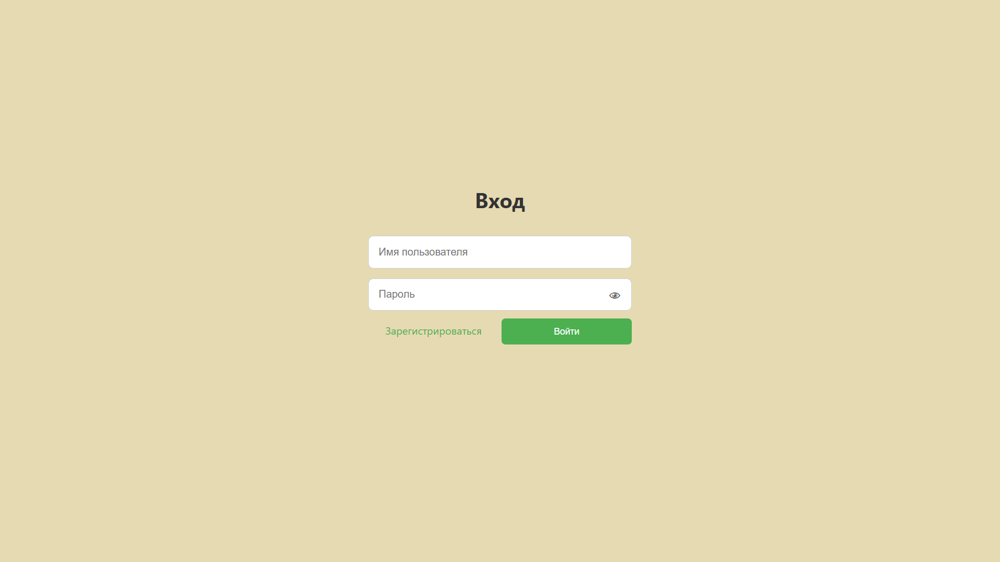
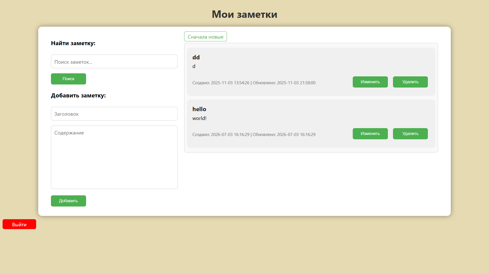
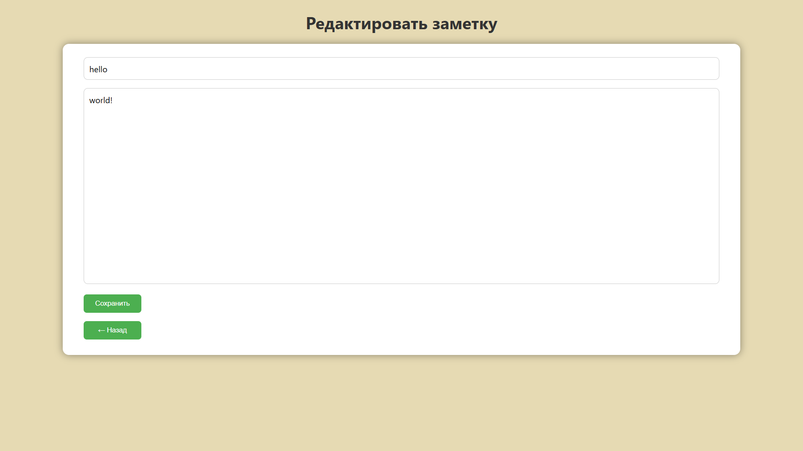

# 📝 Web-Notes

Web-Notes — это веб-приложение для создания и управления заметками с системой пользователей и авторизацией.

🔗 **Demo:** https://web-notes-erc8.onrender.com

---

## Скриншоты
### Авторизация


### Основная страница


### Редактирование


---

## 🚀 Возможности

- Регистрация и авторизация пользователей (Flask-Login)
- Создание, редактирование и удаление заметок (CRUD)
- Поиск и сортировка заметок
- Привязка заметок к пользователю
- Обработка ошибок (403, 404, 500)
- Логирование действий пользователей
- CSRF-защита форм

---

## 🛠 Технологии

- Python
- Flask
- SQLAlchemy
- Flask-Login
- Flask-WTF
- SQLite
- HTML / CSS

---

## ⚙️ Запуск проекта

```bash
git clone https://github.com/your-username/Web-Notes.git
cd Web-Notes

pip install -r requirements.txt
python app.py
```

Для продакшена задайте переменную окружения `SECRET_KEY` (например, в настройках Render):

```bash
python -c "import secrets; print(secrets.token_hex(32))"
```

Без неё приложение сгенерирует случайный ключ при каждом запуске, и пользователей будет разлогинивать после перезапуска.

---

## Лицензия

Проект распространяется под лицензией MIT. Подробнее — в файле [LICENSE](LICENSE).
